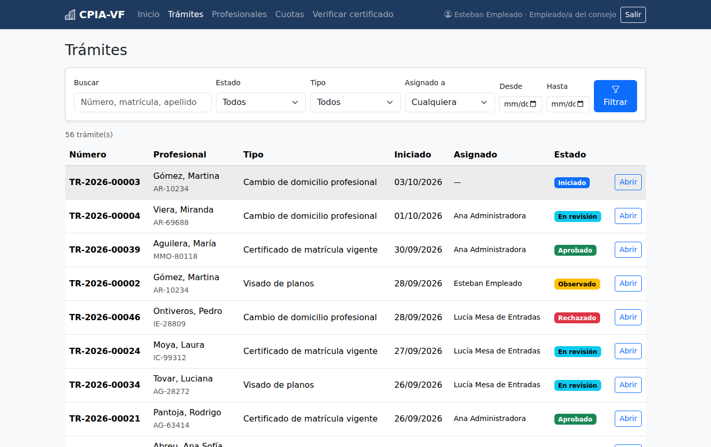
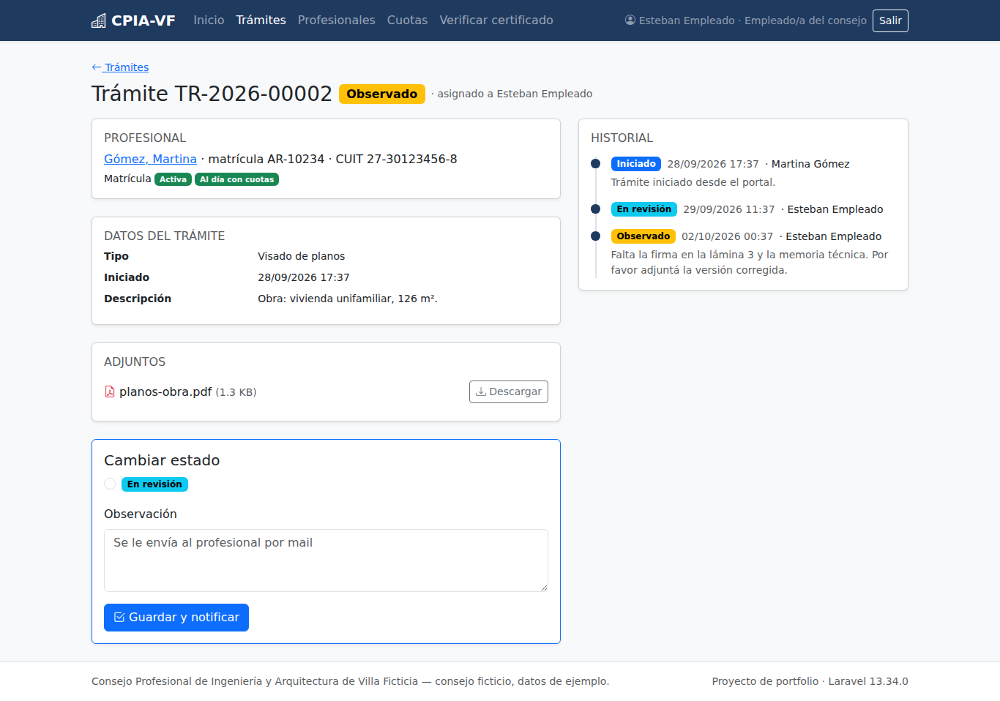
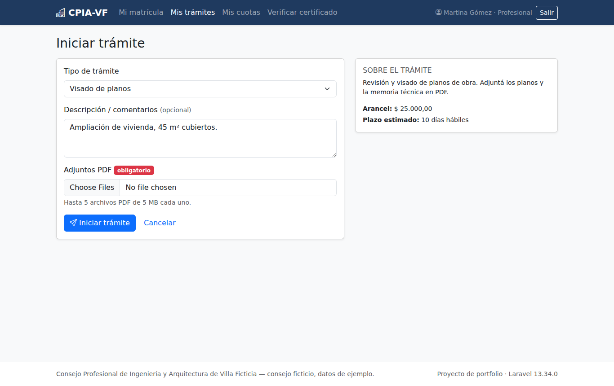
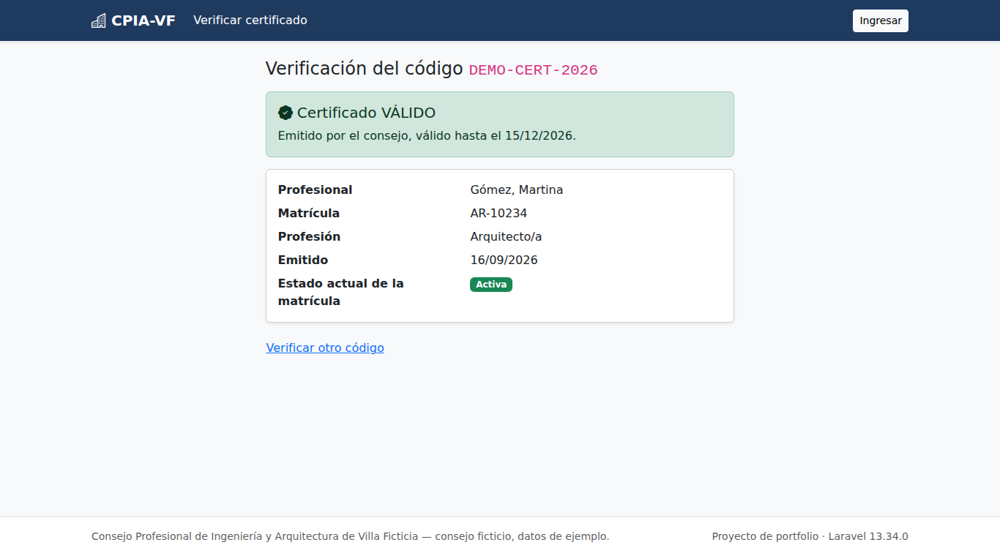

[Versión en castellano](README.md)

# Professional registrations and applications — professional council (Laravel)

> **Portfolio project.** The council ("Consejo Profesional de Ingeniería y Arquitectura de Villa Ficticia", CPIA-VF) does not exist and all data is sample data generated by the seeder. The UI is in Spanish (Argentina), as are the domain names in the code.

A web system for a professional association/council: it keeps the register of **licensed professionals**, receives **applications from a portal** (building plan approval, certificate of good standing, change of address) with PDF attachments, moves them through a **workflow with history** handled by staff, tracks monthly **membership fees** and issues a **PDF certificate with a public verification code**.

## Why I built it

Many **PHP full stack developer** job posts ask for **Laravel, MySQL, HTML/CSS, Bootstrap, jQuery and Git**. I already have several plain-PHP projects; this one shows Laravel used the way the framework intends: Eloquent with relationships and scopes, migrations/seeders/factories, Form Requests, Policies, queues, notifications, Sanctum and feature tests.

## Screenshots

| Staff panel: applications with filters | Application detail with history |
|---|---|
|  |  |

| Professional portal: new application | Public certificate verification |
|---|---|
|  |  |

## What it does

**Roles** (`profesional`, `empleado` = staff, `admin`), with Gates to enter each area and per-model Policies:

- **Professional** (portal `/portal`): sees their registration status and fees, starts applications with PDF attachments, follows the history, answers observations (uploads the fix and the application goes back to review) and downloads their certificates.
- **Staff** (panel `/panel`): application inbox with search (number, registration, last name), filters by status / type / assignee / dates and pagination; changes status with a comment; creates and edits professionals with CUIT validation; records fee payments.
- **Admin**: all of the above, plus suspending / deregistering / reactivating registrations and voiding certificates.

**Application workflow**

```
Iniciado ──► En revisión ──► Aprobado
(Started)    (In review)     (Approved)
                │   ▲    └─► Rechazado (Rejected)
                ▼   │
              Observado (Needs changes)
```

- Valid transitions live in the `EstadoTramite` enum; anything else is rejected.
- "Needs changes" and "Rejected" **require** a comment.
- Every change is stored in `tramite_movimientos` (who, when, from/to status, comment).
- On **approval**: a "certificate of good standing" issues the certificate (only if the registration is active and has no overdue fees); a "change of address" updates the professional's address. If that fails the application is **not** approved (everything runs in one transaction).
- Each status change **emails the professional** (`ShouldQueue` notification → `database` queue → worker). Without Docker it goes to the log; with Docker it shows up in **Mailpit**.

**Fees**: `php artisan cuotas:generar [YYYY-MM]` creates the monthly fee for every active registration (idempotent, scheduled for the 1st of each month). Statuses paid / pending / overdue; staff record payments (method and date) from a modal via AJAX.

**Certificate**: PDF (dompdf) with a code like `K7Q4-M2XP-9HTA` (no look-alike characters such as 0/O or 1/I). Anyone can check it at `/verificar/{codigo}` without logging in: it says whether it is valid, expired or voided, and shows the **current** registration status.

**Small REST API** with Sanctum tokens (look up registrations by number or CUIT, and applications). Documented in [docs/api.md](docs/api.md) (in Spanish).

## Stack

- PHP 8.3, **Laravel 13** (latest stable at the time), Eloquent, **MySQL 8.4** (SQLite for quick local runs and tests)
- Blade + **Bootstrap 5** + Bootstrap Icons + **jQuery** (auto-submitting filters, fields shown per application type, PDF count/size check before upload, CUIT formatting while typing, AJAX payment form, confirmations), bundled with Vite
- Laravel Sanctum (API), barryvdh/laravel-dompdf (PDF), Laravel queues and notifications
- PHPUnit (feature and unit tests), Laravel Pint (code style)
- Docker: Apache + PHP 8.3, queue worker, MySQL 8.4 and Mailpit. CI with GitHub Actions.

## Demo users

Password for all of them: **`demo1234`**

| User | Role | What to look at |
|---|---|---|
| `admin@demo.local` | admin | full panel + suspend registrations / void certificates |
| `empleado@demo.local` | staff | application inbox, professionals, fees |
| `profesional@demo.local` | professional (Martina Gómez, AR-10234) | portal with applications in every status |

Demo certificate code to try verification: **`DEMO-CERT-2026`** → http://localhost:8081/verificar/DEMO-CERT-2026

## Running it

### With Docker (recommended; also on Windows 10 with Docker Desktop)

Requirements: Docker Desktop (on Windows, with WSL 2) and Git.

```bash
git clone <repo-url> tramites-laravel
cd tramites-laravel
docker compose up -d --build
```

- App: http://localhost:8081
- Mailpit (status change emails): http://localhost:8026

On first start the container generates the `APP_KEY`, runs migrations and loads demo data (only if the database is empty). To start over: `docker compose down -v`.

On Windows it is the same from PowerShell. `.gitattributes` forces LF line endings; if the container still fails with `/bin/sh^M` (because of `core.autocrlf`), run `git config core.autocrlf input` and clone again.

### Without Docker

Requirements: PHP 8.3 with `pdo_sqlite` (or `pdo_mysql`), `mbstring`, `intl`, `gd`, `zip`; Composer 2; Node 20.19+ or 22.

```bash
composer install
cp .env.example .env             # Windows: copy .env.example .env
php artisan key:generate
touch database/database.sqlite   # Windows: type nul > database\database.sqlite
php artisan migrate --seed
npm install && npm run build
php artisan serve                # http://localhost:8000
php artisan queue:work           # in another terminal: sends the emails (to storage/logs/laravel.log)
```

To use MySQL, set `DB_CONNECTION=mysql` in `.env` and fill in `DB_HOST`, `DB_PORT`, `DB_DATABASE`, `DB_USERNAME` and `DB_PASSWORD`.

On Windows without Docker the easiest route is Laragon or XAMPP with PHP 8.3 (enable `intl`, `gd`, `zip` and `pdo_sqlite` in `php.ini`).

## Main screens and routes

| Route | Who | What |
|---|---|---|
| `/` | public | home |
| `/verificar`, `/verificar/{codigo}` | public | certificate verification (rate limited) |
| `/login` | public | sign in |
| `/portal` | professional | summary: registration, fees, applications |
| `/portal/tramites`, `/portal/tramites/nuevo` | professional | my applications / start one with PDFs |
| `/portal/cuotas` | professional | my fees |
| `/panel` | staff/admin | dashboard with counters |
| `/panel/tramites` | staff/admin | inbox with filters, search and pagination |
| `/panel/profesionales` | staff/admin | register, create/edit, status change (admin) |
| `/panel/cuotas` | staff/admin | fees with filters and payment recording |
| `/api/v1/...` | Sanctum token | see [docs/api.md](docs/api.md) |

## Technical decisions

- **Business logic in services** (`GestorTramites`, `EmisorCertificados`, `GeneradorCuotas`): web and API controllers only validate (Form Requests) and delegate, so each rule lives in one place and is tested directly.
- **PHP enums** for statuses (application, registration, fee) and roles, including transitions, labels and badge colours, instead of loose strings.
- **Concurrency**: changing status locks the row (`lockForUpdate`) inside the transaction, so two staff members cannot resolve the same application at once.
- **Emails after commit** (`afterCommit()`): if the transaction fails, nobody is notified of something that did not happen.
- **Attachments on the private disk** (`storage/app/private`): downloaded through a route guarded by a Policy, never public. If the database fails while starting an application, already stored files are deleted.
- **CUIT with check digit** (mod 11) in `App\Support\Cuit` + the `CuitValido` rule; stored normalised (11 digits), displayed with dashes.
- **Certificate code** is random (`random_int`) with an unambiguous alphabet; the public page is throttled against brute force and shows the minimum (no contact details).
- **Read-only API** with `JsonResource`s that do not expose personal data, expiring tokens and a login rate limit.
- `Model::shouldBeStrict()` outside production: any N+1 (lazy loading) makes the tests fail.
- `fakerphp/faker` is in `require` (not `require-dev`) because the demo seeder also runs in the Docker image, which is installed without dev dependencies.

## Tests

PHPUnit against **in-memory SQLite** (no database needed): **88 tests, 342 assertions, all passing**.

```bash
php artisan test
# or
composer test
```

They cover: status workflow and invalid transitions, mandatory comments, approval side effects (certificate / address), role permissions in portal, panel and API, PDF uploads (other formats rejected), CUIT validation, fees (idempotent generation, overdue, payment), public certificate verification (valid / expired / voided / unknown), queued notification on status change, and web and API login.

I also checked the migrations on **MySQL 8.4** (`migrate:fresh --seed`, `migrate:rollback` and `migrate` again). CI (`.github/workflows/ci.yml`) runs Pint and the tests, migrations and seeding against a MySQL service, and `docker compose build`.

## Not included / not tested

- No real online payment (staff record payments) and no invoicing.
- No password reset or open sign-up: professionals are created by the council.
- Emails use Laravel's standard layout; no other channels (SMS, WhatsApp).
- The API is read-only.
- **Docker**: in the environment where I built this, Debian package mirrors were blocked, so **I could not build the final stage of the `Dockerfile` as-is** (the `apt-get install libicu-dev` step). I did build the assets stage (Node/Vite) and tested the full `docker-compose.yml` (app + worker + MySQL + Mailpit) with an equivalent Ubuntu-based image using the same code, `entrypoint.sh` and `php.ini`: it started, migrated, seeded demo data, login and panel worked, a status change produced an email that the worker processed and Mailpit received, the API returned data with a token and the certificate PDF downloaded. The repo `Dockerfile` (based on `php:8.3-apache`) should build on a machine with normal internet access, and CI builds it, but I did not see it finish in my environment.
- The GitHub Actions workflow is written but has not been run on GitHub.
- Not tested on Windows; the instructions are the usual Docker Desktop / Laragon steps.

## How to talk about it in an interview

1. It is an application-processing system for a professional council: register of professionals, a portal to start applications with PDFs, an internal panel to resolve them, fees and verifiable certificates.
2. The workflow is a **PHP enum** that knows its allowed transitions; a service (`GestorTramites`) applies the rules inside a **transaction** and records the history.
3. Permissions live in **Policies** (a professional only sees their own applications; only admins suspend registrations) and validation in **Form Requests**; controllers stay short.
4. Emails go through a **queue** (`database` driver) with `afterCommit`, so nothing is announced if it was rolled back; with Docker they show up in Mailpit.
5. Certificates have a **public verification code** anyone can check without logging in, rate limited.
6. I validate the **CUIT check digit** (mod 11) and test it with valid and invalid cases.
7. It has a documented **Sanctum API** and **88 feature and unit tests** on in-memory SQLite; migrations were also checked on MySQL.

**Likely questions**

- *Why a service instead of logic in the controller?* — The portal, the panel and the API all use it; one place for the rule, and I can test it without HTTP.
- *What if two staff members change the same application at once?* — The second waits on `lockForUpdate`, re-reads the status and, if the transition is no longer valid, gets an error instead of overwriting the first.
- *Why both Gates and Policies?* — Gates for "can they enter the panel/portal?" (role only) and Policies for rules about a specific record (is this application theirs?).
- *How do you avoid N+1?* — Eager loading (`with`) in listings and `Model::shouldBeStrict()` in development and tests, which makes lazy loading fail.
- *Why a queue for emails?* — Staff do not wait for the mail server, and failed sends are retried (`tries = 3`).
- *How are attachments protected?* — They live outside `public`, on the private disk, and are downloaded through a Policy-guarded route.
- *What would you improve?* — Online payments with a webhook, an audit log for register changes, a digitally signed PDF and browser tests (Dusk).
